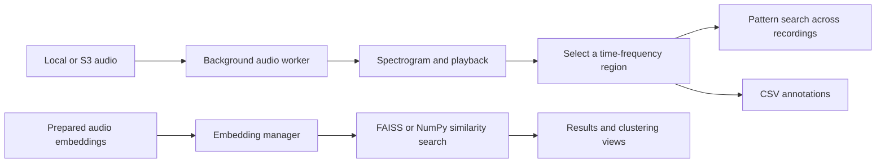
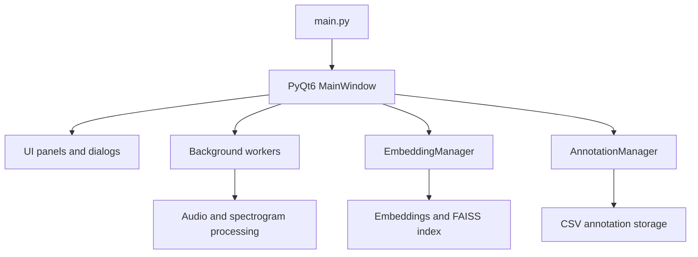

# ECOSURF

ECOSURF is a desktop application for exploring long bioacoustic recordings. It brings audio navigation, spectrograms, pattern search, annotations, and optional embedding-based exploration into one PyQt6 workspace. The project helps a user inspect recordings, compare interesting sounds, and keep track of observations.

This repository is a research prototype. The interface and processing code are present, while some analysis features require audio files or precomputed data that are not distributed here.

## What can you do?

| Task | How ECOSURF supports it |
| --- | --- |
| Explore recordings | Open local audio, navigate through it, inspect a spectrogram, and play selected parts. |
| Find similar patterns | Select a sound region and compare its spectrogram pattern with other audio windows. The search worker uses cosine similarity. |
| Explore embeddings | Load prepared audio embeddings and metadata, then browse similarity results. FAISS is used when available; the code also has a NumPy fallback. |
| Inspect clusters | Review clustering views built from prepared embedding data. |
| Record observations | Create and review audio annotations stored in CSV format. |

Pattern search and embedding search are different paths. Pattern search compares spectrogram content; embedding search needs vectors prepared in advance.

## How the data flows



The audio worker loads recordings and computes spectrogram data without doing that work in the main UI thread. A selected region can then be used for pattern matching or annotation. Embedding exploration starts from separate, precomputed vectors and metadata.

## Application structure



| Location | Responsibility |
| --- | --- |
| `main.py` | Starts the Qt application and opens the main window. |
| `src/ui/` | Panels, dialogs, spectrogram widget, and background workers. |
| `src/core/` | Spectrogram utilities, embedding search, and annotation storage. |
| `pre_processing_data/` | Data preparation helpers and research metadata. |
| `others/` | Optional data setup, notebooks, and research scripts. |

## Run the desktop application

The dependency file recommends **Python 3.10 or 3.11**. Run these commands from the repository root.

On Windows PowerShell:

```powershell
py -3.11 -m venv .venv
.\.venv\Scripts\python.exe -m pip install -r requirements.txt
.\.venv\Scripts\python.exe main.py
```

On macOS or Linux:

```bash
python3.11 -m venv .venv
.venv/bin/python -m pip install -r requirements.txt
.venv/bin/python main.py
```

The GUI needs a desktop environment. Audio playback also needs a working audio device. The large embedding files are optional for launching the application, but are required for embedding search and related clustering views.

## A first exploration

1. Start the application and open an audio recording from the file panel.
2. Navigate through the spectrogram and listen to a region of interest.
3. Select a time-frequency region to search for similar patterns in other recordings.
4. Review the results and add an annotation when you want to keep an observation.
5. If prepared embeddings are available, open the embedding and clustering views to explore similar segments in another way.

The exact results depend on the recordings, search settings, and available embedding data. Review matches in the audio and spectrogram before using them in an analysis.

## Optional data and S3 setup

The repository does not include the large `perch2/` embedding files. The optional `others/setup_data.py` script can download the expected vectors, metadata, and index from an S3-compatible store if you have access.

To use that script, create a **local** `credentials.json` at the repository root with the fields `ACCESS_KEY`, `SECRET_KEY`, `endpoint`, and `bucket`. The file is ignored by Git. Then run:

```bash
python others/setup_data.py
```

If you only want to inspect local audio, you can skip this step. Never commit credentials or private recordings.

## Current scope

ECOSURF is an exploratory desktop project rather than a packaged release. Some modules are research utilities or earlier UI versions, and several features depend on external data. This README describes the code currently in `main`; it does not claim that every workflow has been tested on every platform.
